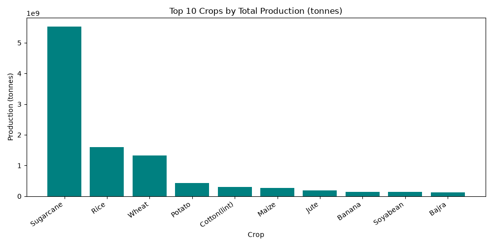

# Crop Production ETL Pipeline

A beginner data engineering project that builds an ETL pipeline using Python, Pandas and SQLite on real crop production data from India.

## What it does
1. Extract: reads the raw CSV file (246,091 rows) with Pandas
2. Transform: trims whitespace from State_Name, District_Name, Season, and Crop; removes duplicate rows and rows with missing Production or Area; removes rows where Area is zero or negative or Production is negative; calculates yield as Production / Area.
3. Load: saves the clean data (242,361 rows) into an SQLite database
4. Analyse: runs SQL queries and draws a chart

## Tools used
Python, Pandas, SQLite, SQL, Matplotlib

## Dataset

This project uses [Crop Production in India](https://www.kaggle.com/datasets/abhinand05/crop-production-in-india), by abhinand05 on Kaggle.

**Units:** Area is measured in hectares. The government dataset catalog describes Production in tonnes. This project treats coconut production as a number of nuts, consistent with a Ministry of Agriculture report. Coconut yield is therefore nuts per hectare and is excluded from comparisons with other crops.

Sources: [Government dataset catalog](https://www.data.gov.in/catalog/district-wise-season-wise-crop-production-statistics-0) · [Ministry of Agriculture report](https://sansad.in/getFile/loksabhaquestions/annex/175/AU3327.pdf?source=pqals)

Download crop_production.csv and put it inside a folder named data.

## How to run
1. Install dependencies: `pip install -r requirements.txt`
2. Download `crop_production.csv` and place it in the `data` folder.
3. Run the pipeline: `python main.py`

## Tests

Run the tests with:

`python -m unittest discover -s tests -v`

## Files
- extract.py: reads the data
- transform.py: cleans the data
- load.py: saves it into the database
- analyse.py: SQL queries and chart
- main.py: runs the whole pipeline

## Chart

